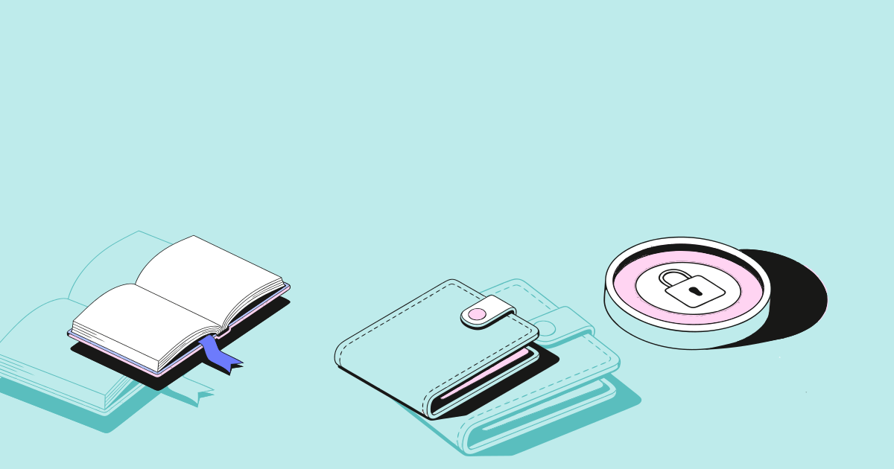
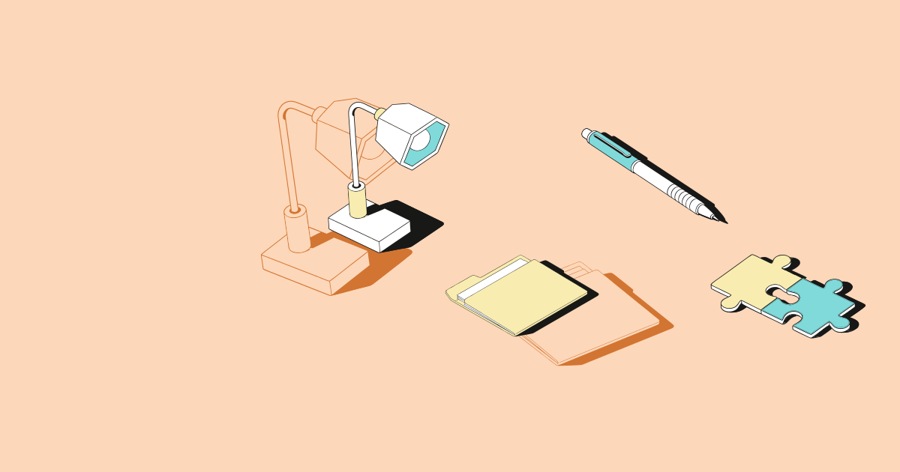
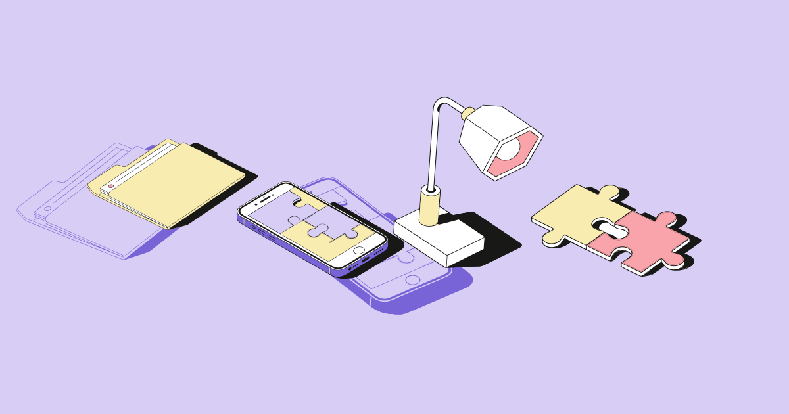

# Сборщик иллюстраций

Веб-сервис, который собирает композиции из готовых векторных иллюстраций (библиотека из макета «Тестовое | иллюстрации»).
Итог — SVG, который остаётся векторным и редактируемым. Новые объекты сервис не создаёт.

## Запуск

Нужны JDK 21 и Maven.

```bash
mvn spring-boot:run
```

Страница откроется на <http://localhost:8080>. Тесты: `mvn test`.

### Подключение ИИ для подбора по метафоре

Подойдёт любая модель. Самый простой путь: нажать кнопку **«Подключить ИИ»** вверху страницы,
выбрать сервис, вписать ключ (для локальных он не нужен) и нажать «Проверить и подключить».

| Сервис | Адрес по умолчанию | Ключ |
|---|---|---|
| Ollama (локально) | `http://localhost:11434/v1` | не нужен |
| LM Studio (локально) | `http://localhost:1234/v1` | не нужен |
| OpenRouter | `https://openrouter.ai/api/v1` | нужен |
| OpenAI | `https://api.openai.com/v1` | нужен |
| Anthropic | `https://api.anthropic.com` | нужен |
| Другой, OpenAI-совместимый | свой адрес | по необходимости |

Без настроек при старте проверяется локальная Ollama, и если она запущена, берётся её первая модель.
Можно задать и заранее: переменные `LLM_PROVIDER`, `LLM_BASE_URL`, `LLM_MODEL`, `LLM_API_KEY`
или `ANTHROPIC_API_KEY` / `OPENROUTER_API_KEY`. Если ИИ не подключён или не ответил,
объекты подбираются по тегам, и интерфейс пишет причину.

## Что умеет

| Блок | Реализация |
|---|---|
| Библиотека SVG | 9 объектов × 2 размера (L, S) × 2 варианта (главный цветной, фоновый одноцветный) — 36 файлов в `src/main/resources/illustrations`. Читаются при старте, содержимое не меняется |
| Сценарий 1 — метафора или заголовок | `LlmPicker` выбирает id из каталога (название + теги); если ИИ не подключён или не ответил — `TagPicker` |
| Сценарий 2 — названия компонентов | `NamePicker`: «книга, лампа и телефон» → объекты, склонения понимает |
| Сборка | Холст в браузере: добавить, перетащить, повернуть, масштабировать, дублировать, удалить, порядок слоёв, размер L/S |
| 3D-предпросмотр | Доска наклоняется за мышью, при автосборке объекты влетают и садятся на место, кнопка «Раздвинуть слои» показывает порядок слоёв в глубину. Это только вид в браузере (CSS 3D): итоговый SVG остаётся плоским |
| Палитры | Три схемы из макета + загрузка своей (6 цветов). Перекраска — замена цветов за один проход |
| Экспорт | `POST /api/export` отдаёт `composition.svg`: фон + по одному `<g transform>` на объект |

## Архитектура

```
Браузер (index.html, app.js, без фреймворков)
   │   холст — SVG: <image> с перекрашенной иллюстрацией + transform
   ▼
ApiController ── ApiErrors (ошибки → 400 {"error": "..."})
   │
   ├─ ComposeService ── два сценария
   │      ├─ LlmPicker  → TagPicker (запасной)     метафора
   │      └─ NamePicker                             названия
   ├─ LayoutService   три шаблона: Собранно / Под заголовок / Со смещением
   ├─ PaletteService  палитры + перекраска
   ├─ LibraryService  library.json + SVG (в памяти)
   └─ SvgRenderer     композиция (JSON) → итоговый SVG
```

### Как хранятся и переиспользуются SVG-элементы

- `library.json` — для каждого объекта `id`, название и теги. Файлы лежат по шаблону
  `illustrations/{L|S}/{id}-{main|bg}.svg`.
- `LibraryService` при старте снимает внешний тег `<svg>`, запоминает размеры и хранит содержимое как есть.
- Композиция — это JSON: размер, палитра и список объектов `{objectId, variant, x, y, rotation, scale}`.
  Порядок списка — порядок слоёв.
- `SvgRenderer` оборачивает исходное содержимое в `<g transform="translate rotate scale translate">`.
  Атрибуты `d` и геометрия путей не изменяются. Меняются только значения `fill` по таблице палитры.
- Правило макета «цвета объектов нельзя использовать в фонах» выполняется само: в фоновых файлах есть только
  два цвета фона.

### Перекраска

Исходные файлы нарисованы в сиреневой схеме. Пять цветов заменяются на роли палитры за один проход
(`Matcher.replaceAll`), поэтому замены не накладываются друг на друга:

| Исходный цвет | Роль |
|---|---|
| `#D7CDF5` | `bgLight` — светлый фон (он же цвет холста) |
| `#7864D7` | `bgDark` — тёмный фон |
| `#F9ECB0` | `objA` |
| `#F9A3AA` | `objB` |
| `#FFE3E1` | `objC` |

Чёрный контур `#181817` и белый остаются. Цвета палитры принимаются только в виде `#RRGGBB`,
потому что попадают прямо в SVG.

### ИИ в подборе

Модель получает только каталог готовых объектов и запрос. Она возвращает JSON-массив id; всё, чего нет в каталоге,
отбрасывается, а рисовать или менять иллюстрации она не может. Если небольшая локальная модель ответила словами,
id ищутся в тексте. Сервис говорит на двух протоколах: OpenAI-совместимом (`/chat/completions`) и Anthropic
(`/v1/messages`). Таймаут запроса — 45 секунд (локальная модель при первом обращении загружается), любая ошибка
переключает подбор на теги, а причина показывается в интерфейсе. Настройки и ключ хранятся только в памяти сервера
и в браузер не возвращаются (`GET /api/llm` отдаёт лишь признак `hasKey`).

## API

| Метод | Путь | Назначение |
|---|---|---|
| GET | `/api/library` | объекты, палитры, шаблоны, размеры исходных SVG |
| GET | `/api/asset/{size}/{id}/{variant}?palette=` | одна иллюстрация в выбранной палитре |
| POST | `/api/compose` | `{mode, query, size, palette, layout, background}` → композиция |
| POST | `/api/palettes` | добавить свою палитру |
| POST | `/api/render` | композиция → SVG |
| POST | `/api/export` | композиция → файл `composition.svg` |
| GET, PUT, DELETE | `/api/llm` | состояние, подключение и отключение ИИ |
| POST | `/api/llm/test` | пробный запрос к подключённой модели |
| GET | `/api/llm/models?provider=` | модели, установленные на локальном сервере |

## Использованные ИИ-инструменты

- **Claude Code** (Anthropic) — основной инструмент разработки. В диалоге с автором разобрали задание и макет в Figma,
  выгрузили иллюстрации в SVG, выбрали архитектуру, написали код, тесты и интерфейс. Решения по архитектуре, подбору
  объектов и внешнему виду принимал автор.
- **Ollama + qwen2.5:7b** — локальная модель, которую сам сервис использует при работе для подбора объектов по метафоре.
  Подключение необязательное: без него объекты подбираются по тегам.

## Примеры

В `examples/` лежат три собранные композиции (L и S, разные палитры и шаблоны). Это готовые SVG, которые отдаёт кнопка «Скачать SVG».

| Обучение и финансы | Идея и документы | Связь и команда |
|---|---|---|
|  |  |  |

## Известные ограничения

- Объектов 9, а не ~20: столько их в библиотеке макета (в двух размерах и двух вариантах).
- Холст фиксированный, 1200×630.
- Своя палитра хранится в памяти и пропадает после перезапуска.
- Автосборка ставит до 5 объектов; вручную их можно добавить больше.
